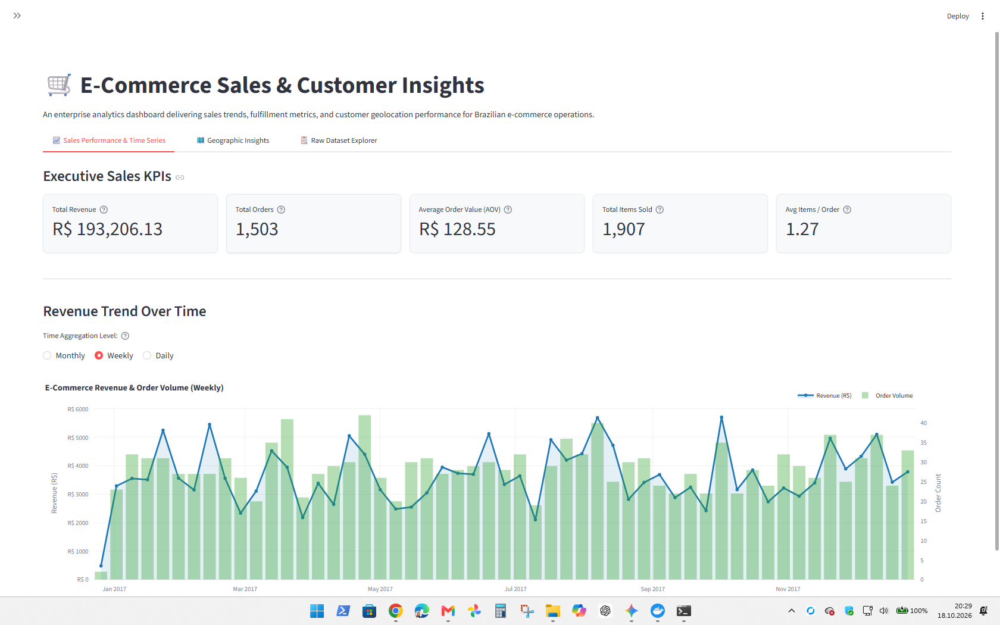
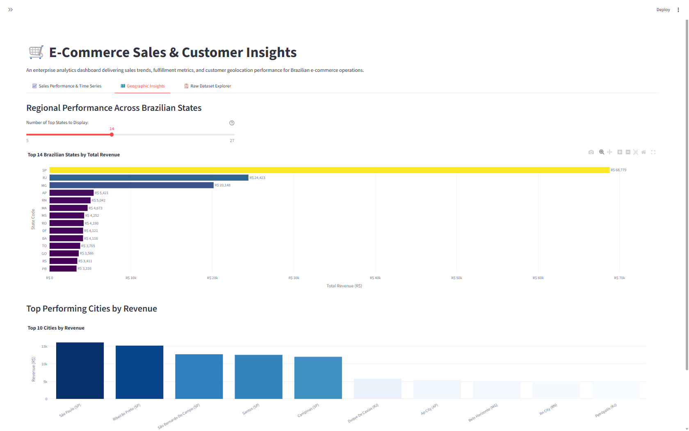

# 📊 E-Commerce Sales & Customer Insights Dashboard

An enterprise-grade modular data analysis pipeline and interactive [Streamlit](https://streamlit.io/) dashboard designed to analyze Brazilian e-commerce performance, customer distributions, and fulfillment trends based on the [Olist Brazilian E-Commerce public dataset](https://www.kaggle.com/datasets/olistbr/brazilian-ecommerce).

---

## 🌟 Key Features

- **Automated Kaggle Ingestion (`src/fetch_data.py`)**:
  - Secure and dynamic cross-platform path resolution using Python's `pathlib`.
  - Automatic download and archive extraction of `olistbr/brazilian-ecommerce` via the Kaggle API.
  - File existence verification preventing redundant downloads.
  - Offline demo sample generator (`--generate-sample`) for instant evaluation without API credentials.
- **High-Performance Data Engineering (`src/data_processing.py`)**:
  - Joins order header attributes (`olist_orders_dataset.csv`), item financials (`olist_order_items_dataset.csv`), and customer geolocation (`olist_customers_dataset.csv`).
  - Order-level aggregation of revenue, shipping freight, and unit item counts.
  - Temporal feature extraction (year, month, quarter, day of week) and Brazilian state normalization.
  - Optimized data loading with Streamlit caching (`@st.cache_data`).
- **Interactive Executive Dashboard (`app.py`)**:
  - **Dynamic Sidebar Controls**: Filter by year, purchase month, custom calendar date range, order status, and Brazilian states (UF).
  - **Tab 1: Sales Performance & Time Series**:
    - Executive KPI Cards: Total Revenue (*Gesamtumsatz*), Order Count (*Anzahl Bestellungen*), Average Order Value (AOV), Total Items Sold, and Units per Order.
    - Interactive dual-axis Plotly time series chart showing sales revenue and order volume trends with toggleable granularity (Monthly, Weekly, Daily).
  - **Tab 2: Geographic Insights**:
    - Ranked Plotly horizontal bar chart of top Brazilian states with revenue, percentage market share, and average basket sizes.
    - Ranked breakdown of top municipal cities by revenue.
  - **Tab 3: Raw Dataset Explorer**:
    - Embedded inside a collapsible `st.expander` container as required.
    - Interactive `st.dataframe()` with search capabilities across Order IDs, Customer IDs, and Cities.
    - One-click CSV export of filtered analytical records.

---

## 📸 Dashboard Screenshots

### 1. Sales Performance & Time Series


### 2. Geographic Insights


---

## 🏗️ Project Architecture

```text
E-Commerce-Sales-Analytics-Dashboard/
│
├── .gitignore                      # Git ignore rules for virtual environments, caches, and raw CSVs
├── LICENSE                         # Repository license
├── README.md                       # Comprehensive project documentation
├── requirements.txt                # Python project dependencies
├── app.py                          # Streamlit dashboard entry point
│
├── data/                           # Data storage folder
│   ├── .gitkeep                    # Directory tracking placeholder
│   ├── olist_orders_dataset.csv
│   ├── olist_order_items_dataset.csv
│   └── olist_customers_dataset.csv
│
└── src/                            # Modular Python backend package
    ├── __init__.py                 # Package initializer
    ├── fetch_data.py               # Kaggle API automated ingestion routine
    └── data_processing.py          # Data cleaning, aggregation, merging, and caching